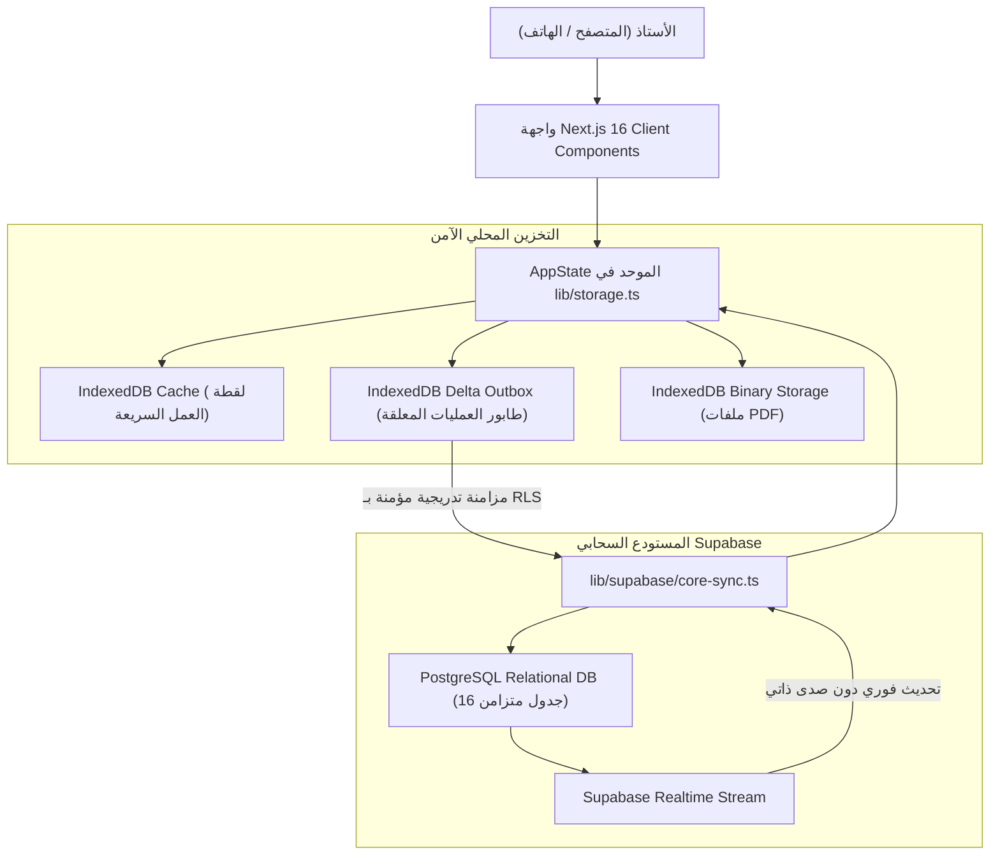

# معين الأستاذ — Mueen Al-Ostad

دفتر عمل رقمي متكامل وتطبيق ويب تقدمي (PWA) مخصص لأستاذ العلوم الإسلامية في مرحلة التعليم الثانوي بالجزائر. يهدف التطبيق إلى تحويل المهام اليومية المتناثرة — من إدارة الأقسام ورصد الغيابات، إلى التقييم المستمر، وبرمجة الحصص، وتوثيق دفتر النصوص، وإعداد مجالس الأقسام وتصدير الوثائق الرسمية — إلى مساحة عمل موحدة ذكية تعمل بكفاءة عالية على الحاسوب والهاتف، متصلةً بالسحابة أو دون اتصال بالإنترنت (Offline-First).

**رابط الإنتاج الرسمي:** [https://ostady.vercel.app](https://ostady.vercel.app)

---

## الهوية وشعار المنتج

- **الشعار والرمز:** ريشة قلم حبر كلاسيكية تنبثق من كتاب مفتوح مع ألوان مائية بترولية ولمسات ذهبية رصينة (`#E1EDF6` / `#2E7D9B` / `#1E4056` / `#CBA135`).
- **حزمة PWA في `public/`:**
  - `brand-logo-text.png`: الشعار الكامل مع كاليغرافي "مُعِين" لشاشات الترحيب والواجهة.
  - `pwa-192x192.png` و `pwa-512x512.png`: أيقونات التطبيق للشاشات المحمولة.
  - `pwa-maskable-512x512.png`: مطابقة لمعيار التكيف مع شاشات Android (Adaptive Icons).
  - `apple-touch-icon.png`: أيقونة خاصة بأجهزة iOS وiPadOS.
  - `favicon.ico`: أيقونة شريط العنوان متعددة المقاسات.
- **التصميم البصري:** واجهة عربية أصيلة بنظام RTL بالكامل، ذات مظهر فاتح وأنيق يلتزم بمتغيرات الألوان الرسمية المعرّفة في `app/globals.css`.

---

## الوظائف ومساحات العمل (Features & Workspaces)

يوفر التطبيق 13 مساحة عمل مستقلة ومترابطة عبر مسارات مخصصة دون الاعتماد على علامات تبويب مبهمة:

| المسار | مساحة العمل | ما ينجزه الأستاذ |
| :--- | :--- | :--- |
| `/dashboard` | **لوحة التحكم المركزية** | بطاقة الحصة الذكية («جاهز لحصة اليوم؟»)، متابعة آخر عمل، إحصائيات سريعة للطلاب والأقسام والساعات، وحالة المزامنة السحابية اللحظية. |
| `/classes` | **إدارة الأقسام** | إنشاء وتعديل وحذف الأقسام التربوية، مع حساب الحجم الساعي الأسبوعي آلياً (ساعة واحدة لـ 1 ج.م علوم وساعتان لبقية الشعب والمستويات). |
| `/students` | **إدارة التلاميذ** | إضافة التلاميذ يدوياً أو عبر اللصق السريع مع ترقيم آلي، واستيراد قوائم الرقمنة (Excel متعدد الأوراق) وملفات برنامج «الممتاز». |
| `نافذة منبثقة` | **ملف التلميذ (`StudentProfileOverlay`)** | بطاقة موحدة وشاملة للقراءة فقط تُفتح من اسم التلميذ في أي جدول أو من البحث السريع؛ تعرض مؤشرات التقويم، وسجل الحضور، ونتائج الفصول السابقة دون صفر جزافي عند نقص الأدلة (`—`). |
| `/timetable` | **استعمال الزمن** | محرر أسبوعي تفاعلي من الأحد إلى الخميس صباحاً ومساءً، لتوزيع الحصص وربطها بالقاعات والأقسام مع حساب مجموع الساعات الأسبوعية. |
| `/attendance` | **الحضور والانضباط** | كشف الحضور اليومي باختيار آلي للحصة المستحقة، تسجيل الغياب بنقرة واحدة، رصد المخالفات السلوكية والمشاركات الإيجابية، وجولة تفتيش الكراس الفصلية. |
| `/sessions` | **دفتر النصوص اليومي** | توثيق الحصص المنجزة وعناصر الدرس والواجبات، مع ترقيم عناوين الحصص وقت العرض وفق وتيرة الإنجاز الفعلية، وعزل ملاحظات كل قسم عن الآخر. |
| `/grades` | **رصد العلامات والتقويم** | حساب التقويم المستمر بالقرار الوزاري (3/3/6/8)، نافذة مراجعة تقدير المشاركة، رصد الفروض والاختبارات، وحساب المعدلات الفصلية آلياً واستيراد النقاط. |
| `/council` | **مجالس الأقسام** | تحليل بيداغوجي وإحصائي فوري للقسم (نسبة النجاح، المعدل العام، أعلى وأدنى معدل)، التوزيع الفئوي الرسمي، وتقرير بيداغوجي نصي جاهز للإدارة. |
| `/annual-distribution` | **التوزيع السنوي** | مخطط المنهاج عبر الفصول الدراسية الثلاثة والميادين الأربعة للعلوم الإسلامية بالتعليم الثانوي مع توضيح المحطات التقويمية والعطل الرسمية. |
| `/curriculum` | **المنهاج الدراسي** | متابعة إنجاز الوحدات التعليمية الـ 24 الرسمية، وبطاقات تفصيلية للأهداف والكفاءات والمراجع. |
| `/lesson-preparation` | **التحضير البيداغوجي** | بطاقات التحضير وسيرورة التعلم، مؤشرات الكفاءة، ودمج المذكرات بصيغة PDF وتصديرها بصيغة Word. |
| `/documents` | **المطبوعات والوثائق الرسمية** | تصدير كشوف النقاط، ودفتر النصوص، وجداول الإحصاء، واستعمال الزمن بتنسيقات طباعة A4 معزولة ومستندات Word (`.docx`) رسمية مطابقة للمواصفات. |
| `/settings` | **الإعدادات والنسخ الاحتياطي** | ضبط هوية الأستاذ والمؤسسة، التقويم الدراسي وتواريخ الفصول، قواعد وخصومات التقويم المستمر، وأدوات التصدير والاستيراد للأرشيف (JSON/ZIP). |

---

## نظام التقويم المستمر المعتمد (القرار الوزاري 3/3/6/8)

يعتمد التطبيق بدقة النموذج الرسمي للتقويم المستمر في مرحلة التعليم الثانوي بمجموع **20 نقطة**:

$$\text{المعدل الفصلي} = \frac{(\text{التقويم المستمر} + \text{الفرض}) + (\text{الاختبار} \times 2)}{4}$$

### عناصر التقويم المستمر وقواعد الحساب

1. **السلوك والانضباط (3 نقاط):**
   - يبدأ التلميذ بـ 3/3 ويُخصم **0.5 عن كل مخالفة** مسجلة من المخالفة الأولى، بأرضية 0.
2. **المواظبة والحضور (3 نقاط):**
   - يبدأ التلميذ بـ 3/3 ويُخصم **0.5 عن كل غياب غير مبرر**. التأخر والغياب المبرر لا يخصمان ويبقيان للمتابعة التربوية فقط.
3. **الكراس وأدوات التعلم (6 نقاط):**
   - مراقبة فصلية **واحدة** بأربع حالات مباشرة:
     - مكتمل ومنظم: **6**
     - جيد، مع نقص طفيف: **4**
     - ناقص أو غير منظم: **2**
     - منعدم أو لم يحضر الكراس: **0**
   - المراقبة الفصلية هي المصدر الوحيد؛ والملاحظات اليومية القديمة لا تدخل الحساب.
4. **المشاركة والنشاط الصفي (8 نقاط):**
   - **توثيق آلي (4 نقاط):** يُقاس على الحصص الموثقة فعلياً، ويبلغ سقفه (4/4) عند نسبة مشاركة 30% من الحصص، وما دون ذلك يُحسب تناسبياً: $4 \times \min(1, \frac{\text{النسبة}}{0.30})$.
   - **تقدير الأستاذ (4 نقاط):** ثلاث حالات يحددها الأستاذ: مبادر ومتميز (4)، متوسط (2)، سلبي (0). يُقترح «متوسط (2)» افتراضياً ولا يُحفظ إلا بزر «تطبيق على القسم».
5. **قاعدة الأدلة واستبعاد النقص:**
   - الكراس غير المراقب أو المشاركة غير الموثقة يُستبعدان من الحساب وتُعاد نسبة المجموع إلى 20؛ لا يُمنح التلميذ صفراً جزافياً على نقص التسجيل بل تظهر علامة `—`.

---

## معمارية البيانات والمزامنة السحابية (Architecture & Cloud Sync)

يعمل التطبيق وفق معمارية هجينة متطورة تجمع بين **السرعة الفائقة محلياً** و**المزامنة السحابية الفورية الآمنة**:



- **مصدر الحقيقة:** خادم Supabase السحابي هو المرجع المعتمد للحالة عند الاتصال.
- **طابور التعديلات التفاضلي (Delta Mutations Outbox):** كل تعديل (إضافة، تعديل، حذف) يسجل كعملية مستقلة تحمل معرف المالك والجهاز والمراجعة، ويتم تفريغه تلقائياً عند توفر الشبكة.
- **شواهد الحذف الصارمة (`sync_tombstones`):** تمنع إعادة ظهور السجلات المحذوفة عند المزامنة بين أجهزة متعددة.
- **أمان عزل المستخدمين (RLS):** جميع الجداول محمية بسياسات `auth.uid() = user_id` لضمان خصوصية تامة لكل أستاذ.
- **استيراد القوائم الآمن (Merge-Only):** استيراد ملفات Excel لا يحذف أي تلميذ أو نقطة مسجلة مسبقاً، بل يدمج البيانات الإضافية فقط.

---

## البنية التقنية (Tech Stack)

- **إطار العمل الأساسي:** [Next.js](https://nextjs.org/) 16.3.8 مع App Router.
- **المكتبة التفاعلية:** [React](https://react.dev/) 19 و[TypeScript](https://www.typescriptlang.org/).
- **التصميم والتنسيق:** [Tailwind CSS](https://tailwindcss.com/) v4 و[`lucide-react`](https://lucide.dev/).
- **المستودع السحابي والمصادقة:** [Supabase](https://supabase.com/) (PostgreSQL + Row Level Security + Realtime + Storage).
- **التخزين المحلي وPWA:** IndexedDB (`idb-keyval`) وService Worker المخصص.
- **المعالجة والتصدير:**
  - `lib/docx-exporter.ts`: توليد مستندات Word رسمية بمواصفات OOXML وA4 وRTL.
  - `lib/print.ts`: طباعة معزولة دقيقة داخل إطار مخفي بمقاس A4.
  - `xlsx`: تحليل ملفات الرقمنة المتعددة محلياً دون رفعها لأي خادم وسيط.
- **الاختبارات وضمان الجودة:** [Vitest](https://vitest.dev/) مع **427 اختباراً آلياً** بنسبة نجاح 100%.

---

## بنية المجلدات الرئيسية

```text
app/                   # مسارات App Router والصفحات وتكوين PWA والأنماط
components/            # مكونات مساحات العمل الـ 13 والحوارات المشتركة
hooks/                 # hooks المزامنة وإدارة الحالة (useCloudAppState)
lib/
  storage.ts           # عقد الحالة AppState ونماذج البيانات
  grade-calculator.ts  # محرك حساب التقويم الوزاري والمعدلات
  student-profile.ts   # محرك قراءة ملف التلميذ الموحد
  docx-exporter.ts     # محرك تصدير مستندات Word الرسمية
  excel-sync.ts        # مستورد قوائم الرقمنة من Excel
  supabase/            # عميل Supabase ومنطق المزامنة السحابية
supabase/migrations/   # مخطط قاعدة البيانات وسياسات RLS والفهارس
__tests__/             # 427 اختبار وحدة وتكامل مؤتمت
public/                # أيقونات PWA والشعار والمذكرات الرسمية
```

---

## التشغيل والتطوير المحلي (Developer Setup)

### 1. المتطلبات الأساسية
- بيئة تشغيل **Node.js** إصدار 20 أو أحدث.
- مدير الحزم `npm`.

### 2. التثبيت والتشغيل
```bash
# استنساخ المستودع
git clone https://github.com/hichamweblog/Ostad.git
cd Ostad

# تثبيت الحزم
npm install

# تشغيل خادم التطوير عبر Webpack
npm run dev
```
افتح المتصفح على: `http://localhost:3000`.

### 3. إعداد متغيرات البيئة السحابية (اختياري للوضع المحلي)
أنشئ ملف `.env.local` في جذر المشروع:
```env
NEXT_PUBLIC_SUPABASE_URL=https://your-project.supabase.co
NEXT_PUBLIC_SUPABASE_ANON_KEY=your-anon-key
```

### 4. حزمة الاختبارات والفحص الشامل
وفق ضوابط الجودة المعتمدة في المستودع:
```bash
npm run lint    # فحص خلو الكود من الأخطاء والتحذيرات (0 errors, 0 warnings)
npm run test    # تشغيل 427 اختباراً آلياً في Vitest
npm run build   # بناء حزمة الإنتاج
```

---

## المرجع التوثيقي والقواعد الملزمة

- يعد ملف **[`AGENTS.md`](./AGENTS.md)** مصدر الحقيقة الوحيد والملزم لجميع وكلاء الذكاء الاصطناعي والمطورين فيما يتعلق بقواعد المزامنة، وعقود البيانات، ومحددات الواجهة، والقرارات الوزارية.
- التوثيق ينحصر حصراً في ملفي `README.md` و`AGENTS.md` لتفادي التشتت وضمان وحدة المرجع.

---

**الترخيص والتطوير:** تطوير شخصي موجّه لخدمة أساتذة التعليم الثانوي بالجزائر. جميع الحقوق محفوظة © 2026.
